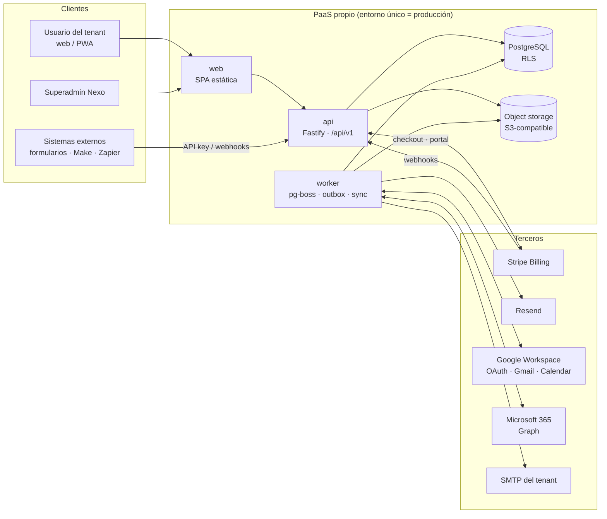
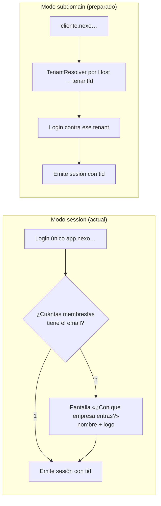
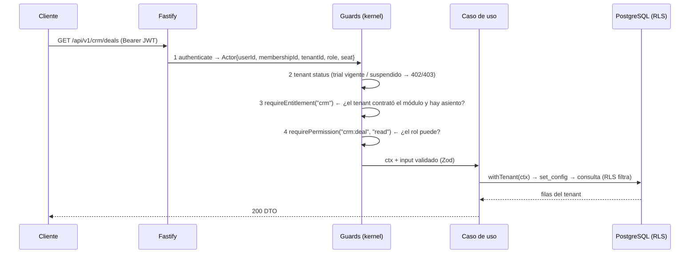
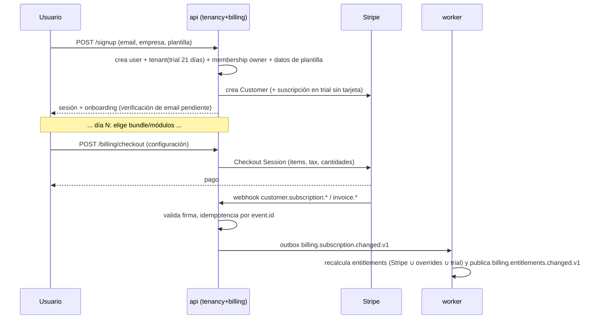
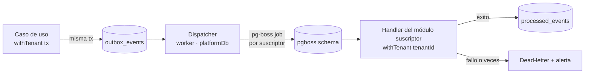
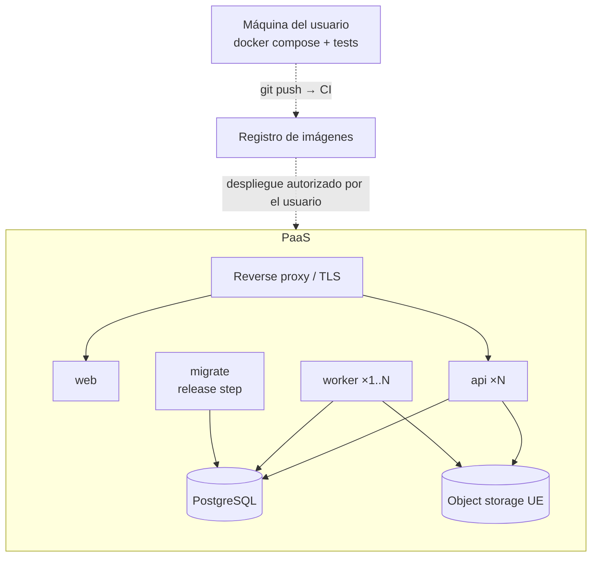

# ARCHITECTURE.md — Nexo

Arquitectura de referencia de Nexo v2. Documento normativo: si el código lo contradice, o se corrige el código o se escribe un ADR que cambie este documento.

Convenciones: **MUST/DEBE** = obligatorio; **SHOULD/DEBERÍA** = por defecto, desviarse requiere justificarlo; «_(por defecto)_» = decisión provisional que debe implementarse como configuración.

## Índice

1. [Visión y principios](#1-visión-y-principios)
2. [Vista general del sistema](#2-vista-general-del-sistema)
3. [Estilo arquitectónico y capas](#3-estilo-arquitectónico-y-capas)
4. [Módulos y reglas de dependencia](#4-módulos-y-reglas-de-dependencia)
5. [Multitenancy: pool con `tenant_id` y RLS](#5-multitenancy-pool-con-tenant_id-y-rls)
6. [Resolución de tenant](#6-resolución-de-tenant)
7. [Identidad, sesión y autorización](#7-identidad-sesión-y-autorización)
8. [Entitlements y facturación (Stripe)](#8-entitlements-y-facturación-stripe)
9. [Eventos, outbox y trabajos asíncronos](#9-eventos-outbox-y-trabajos-asíncronos)
10. [Integraciones, correo y API pública](#10-integraciones-correo-y-api-pública)
11. [Documentos y PDF por tenant](#11-documentos-y-pdf-por-tenant)
12. [Archivos](#12-archivos)
13. [Frontend](#13-frontend)
14. [Seguridad y privacidad](#14-seguridad-y-privacidad)
15. [Observabilidad](#15-observabilidad)
16. [Despliegue y operación](#16-despliegue-y-operación)
17. [Registro de decisiones y decisiones abiertas](#17-registro-de-decisiones-y-decisiones-abiertas)

---

## 1. Visión y principios

### 1.1 Principios

1. **Monolito modular.** Una unidad de despliegue (más un proceso worker de la misma base de código), límites de dominio estrictos, eventos internos. Microservicios solo cuando exista una razón medible (criterios en §16.4).
2. **Aislamiento por defecto, en dos niveles.** (a) _Datos entre tenants_: RLS en la base de datos, no solo filtros en código. (b) _Código entre módulos_: dependencias prohibidas verificadas en CI. Ambos protegen el negocio: el primero evita fugas de datos, el segundo permite vender módulos por separado.
3. **Una fuente de verdad por dominio.** Cada módulo es dueño de sus tablas y de sus datos; comparte identificadores y eventos, nunca tablas.
4. **Opinado, configurable dentro de límites.** Plantillas verticales y flujo guiado; sin _custom objects_ ni código por cliente.
5. **Valor antes que configuración.** El onboarding entrega valor en < 30 minutos (PDF §08).
6. **Los límites comerciales son técnicos.** El pricing modular (usuarios Full/Light, módulos, consumo) se aplica con _entitlements_ comprobados en servidor, no en la interfaz.
7. **Mantenible por una persona.** Preferir lo aburrido y conocido; todo proceso documentado; comentarios sobre el _porqué_.

### 1.2 Lecciones de la v1 (prueba de concepto `CRM`)

| Problema en v1 | Decisión en v2 |
|---|---|
| Alcance descontrolado (~27 módulos con un MVP de 3). | Alcance cerrado por el PDF; regla de oro 9 en AGENTS.md; módulos fuera de alcance listados en MODULES_SPEC §1. |
| Módulos muy acoplados (p. ej. el TPV obligó a exceptuar un endpoint de inventario del control de módulo). | Aislamiento verificado en CI; comunicación por eventos y puertos; cada módulo es vendible solo (§4). |
| Schema-per-tenant: parche de FKs de Drizzle, `search_path` en pool, migraciones por schema, catálogo de módulos sembrado a mano, tabla `tenant_user_lookup` duplicada, techo de ~1-2k schemas. | Pool compartido con `tenant_id` + RLS forzada; una sola migración; test automático de cobertura RLS (§5). |
| Alta de tenants solo manual y facturación manual; solo se aplicaba `max_users`. | Alta self-service **y** manual; Stripe Billing; entitlements con asientos, límites y metering (§8). |
| Jobs con `node-cron` dentro del proceso API (se duplicarían con varias instancias); email SMTP síncrono. | Outbox transaccional + `pg-boss` en un proceso worker con reintentos y DLQ (§9). |
| PDFs generados en el navegador y enviados en base64. | Generación en servidor con plantilla por tenant (§11). |
| Token de acceso solo en memoria (se perdía al recargar); el superadmin sin refresh. | Refresh en cookie `httpOnly` con rotación para todos, restauración silenciosa al cargar (§7.3). |
| README y documentos obsoletos; conocimiento atrapado en la memoria de la sesión. | `AGENTS.md`, ADRs y `docs/STATUS.md` obligatorios, actualizados en el mismo commit. |
| Sin CI. | CI desde el hito 0 con aislamiento, fronteras, tipos, lint, tests y e2e. |

Lo que **se conserva** de v1: panel de superadmin separado (`scope: platform`), dos capas de acceso (módulo contratado + permiso por rol), `AuthProvider` desacoplado, tenant demo con reseteo, Argon2id, refresh rotado, tema por variables CSS, monorepo pnpm con paquete compartido de Zod.

---

## 2. Vista general del sistema



Procesos desplegables (misma imagen Docker salvo `web`):

| Proceso | Comando | Responsabilidad |
|---|---|---|
| `web` | servidor estático (Caddy/nginx) | SPA/PWA, sin lógica de negocio. |
| `api` | `node dist/api.js` | HTTP: sesión, REST `/api/v1`, webhooks entrantes (Stripe, proveedores). |
| `worker` | `node dist/worker.js` | Dispatcher del outbox, jobs (`pg-boss`), sincronización de buzones, importaciones, envío de emails, metering, tareas programadas. |
| `migrate` | `node dist/migrate.js` | Paso de _release_: aplica migraciones con el rol `nexo_owner` y termina. |

---

## 3. Estilo arquitectónico y capas

Monolito modular con **arquitectura por capas pragmática** dentro de cada módulo (hexagonal ligera, sin ceremonia DDD innecesaria):

```
modules/<modulo>/
├── index.ts            ← ÚNICA superficie pública del módulo (registro, tipos públicos)
├── README.md           ← qué hace, eventos que emite/consume, puertos, cómo probarlo
├── domain/             ← entidades, value objects, reglas puras. Sin I/O. Sin imports de librerías de infraestructura.
├── application/        ← casos de uso (servicios de aplicación). Orquesta dominio + puertos. Define transacciones.
├── ports/              ← interfaces que el módulo NECESITA de fuera (p. ej. ContactLookup)
├── infrastructure/     ← repositorios Drizzle, adaptadores (S3, Stripe, Gmail…). Implementa puertos.
├── http/               ← rutas Fastify, esquemas Zod de entrada/salida, mapeo a casos de uso
├── events/             ← handlers de eventos consumidos y publicación de eventos emitidos
├── jobs/               ← definiciones de jobs del módulo
└── __tests__/          ← tests del módulo (unit + integration)
```

Reglas de capas (verificadas por `dependency-cruiser`):

- `domain` no importa nada fuera de `domain` (ni Drizzle, ni Fastify, ni Zod de transporte).
- `application` importa `domain` y `ports`; **nunca** `infrastructure` ni `http`.
- `infrastructure` y `http` importan hacia dentro (`application`, `domain`), nunca entre sí.
- Un caso de uso recibe el contexto (`TenantContext`, `Actor`) explícitamente; no hay estado global.

**Composición:** `apps/api/src/composition/` es el único sitio que conoce a todos los módulos. Registra rutas, suscriptores de eventos, jobs y cablea los **adaptadores de puertos** entre módulos (ver §4.3). Los módulos no se conocen entre sí.

Transacciones: un caso de uso que escribe abre una transacción con `withTenant()` (§5.2); el evento de dominio se inserta en la tabla `outbox_events` **en la misma transacción** (§9).

---

## 4. Módulos y reglas de dependencia

### 4.1 Mapa de módulos (código ↔ módulos comerciales del PDF)

| Módulo de código | Tipo | Módulo comercial (PDF) |
|---|---|---|
| `platform/` (núcleo compartido, no es módulo) | Kernel | Transversal: DB, tenant context, outbox, errores, logger, config, i18n de errores. |
| `identity` | Plataforma | Platform Core — usuarios, sesión, invitaciones, roles. |
| `tenancy` | Plataforma | Platform Core — tenants, ajustes, alta self-service/manual, superadmin, plantillas verticales. |
| `billing` | Plataforma | Platform Core — Stripe, catálogo, suscripciones, entitlements, metering. |
| `audit` | Plataforma | Platform Core — auditoría y telemetría de producto. |
| `files` | Plataforma | Platform Core — archivos y exportaciones. |
| `documents` | Plataforma | Plantillas y PDFs por tenant (§11). |
| `integration` | Plataforma | API keys, webhooks salientes, formulario de captación, credenciales de terceros. |
| `crm` | **Negocio (Core)** | CRM y Sales Core. |
| `communication` | **Negocio (Core)** | Comunicación (email/calendario, envío). |
| `delivery` | **Negocio (Core)** | Delivery Lite (y base de Projects & Time Pro). |
| `data-import` | **Negocio (Core)** | Data Onboarding (importar/exportar). |
| `insights` | **Negocio (Core)** | Insights Basic (dashboards). |
| `onboarding` | Negocio (Core) | Onboarding: wizard, plantilla vertical, checklist de activación. |

Los add-ons futuros (`sales-pro`, `projects-pro`, `support`, `automation`…) serán módulos nuevos con las mismas reglas.

### 4.2 Reglas de dependencia (DEBEN cumplirse; `pnpm check:boundaries`)

```mermaid
flowchart TD
  subgraph NEG["Módulos de negocio"]
    crm; communication; delivery; data-import; insights; onboarding
  end
  subgraph PLA["Módulos de plataforma"]
    identity; tenancy; billing; audit; files; documents; integration
  end
  K[platform/ kernel]
  C[@nexo/contracts<br/>eventos + DTOs públicos]

  NEG --> K
  PLA --> K
  NEG --> C
  PLA --> C
  data-import -. "puerto ImportTarget<br/>(adaptador en composición)" .-> crm
  communication -. "puerto ContactLookup" .-> crm
```

1. **Prohibido** `import` entre módulos (`crm` ↛ `delivery`, `delivery` ↛ `crm`, etc.). Excepción cero: ni siquiera de tipos; los tipos compartidos viven en `@nexo/contracts`.
2. Todo módulo puede importar `platform/` (kernel) y `@nexo/contracts`.
3. Los módulos de **negocio** no importan módulos de **plataforma** directamente. Necesitan autenticación, entitlements y auditoría a través de **hooks del kernel** (middleware de Fastify registrados en la composición) y de puertos del kernel (`AuditLogger`, `FileStorage`, `DocumentRenderer`).
4. Un módulo **nunca** lee ni escribe tablas de otro módulo. Ni siquiera con SQL directo. Las tablas de un módulo llevan su prefijo (`crm_*`, `delivery_*`…).
5. Los identificadores entre módulos se guardan como `uuid` **sin FK entre módulos** (sí FK compuestas dentro del módulo y hacia `tenants`). La integridad entre módulos se mantiene por eventos (ver §9.4).
6. Las vistas SQL o _joins_ entre tablas de módulos distintos están prohibidos; para informes transversales, `insights` construye sus propios _read models_ alimentados por eventos.
7. Cualquier excepción requiere un ADR aprobado por el usuario.

### 4.3 Cómo colaboran sin conocerse

Tres mecanismos, por orden de preferencia:

1. **Eventos de dominio** (asíncrono, desacoplado): `crm.deal.won.v1` → `delivery` crea el proyecto. Los esquemas viven en `@nexo/contracts/events`. Ver §9.
2. **Puertos y adaptadores** (síncrono, cuando hace falta una respuesta): el módulo que necesita algo declara un **puerto** (interfaz) en su `ports/`; el módulo que lo ofrece publica un **adaptador** en su `index.ts`; la composición los enlaza. Ejemplo: `communication` declara `ContactLookup.findByEmail(ctx, email)` y `crm` lo implementa; si mañana `communication` se vende sin `crm`, se le inyecta otro adaptador (o ninguno, con degradación elegante).
3. **Slots de interfaz** (frontend): un módulo registra widgets en puntos de extensión que otro módulo expone (p. ej. `delivery` registra «Proyectos» en la ficha de cuenta de `crm`) (§13.3).

> `crm` + `platform` constituyen el **Core** y siempre están presentes. Los add-ons dependen _como mucho_ del Core, nunca entre sí (excepción documentada: `billing`/Billing & Payments consume eventos de `delivery`; sigue siendo por eventos, no por import).

---

## 5. Multitenancy: pool con `tenant_id` y RLS

### 5.1 Decisión

Un único PostgreSQL, tablas compartidas con `tenant_id`, **Row-Level Security forzada** como defensa principal, más filtros explícitos en los repositorios como defensa en profundidad. Justificación y comparación con v1 en §1.2 y D-02 (§17.1). Es el modelo _pool_ de AWS/Microsoft recomendado por el PDF (S11, S12) para los primeros cientos de tenants.

### 5.2 Mecánica

**Roles de base de datos** (creados por migración inicial):

| Rol | Atributos | Lo usa | Para qué |
|---|---|---|---|
| `nexo_owner` | Propietario del esquema, `BYPASSRLS` | Solo `migrate` | DDL y migraciones. |
| `nexo_app` | `NOLOGIN`-heredable, **sin** `BYPASSRLS`, solo DML | Pool de aplicación (`appDb`) | Todo el código de módulos de negocio y la mayoría de plataforma. **RLS siempre aplica.** |
| `nexo_platform` | `BYPASSRLS`, DML acotado | Pool de plataforma (`platformDb`) | Operaciones legítimamente transversales (§5.3). |

**Contexto de tenant por transacción:**

```ts
// platform/db/withTenant.ts  (esquema; el comentario de seguridad es obligatorio en el código real)
export async function withTenant<T>(ctx: TenantContext, fn: (tx: Tx) => Promise<T>): Promise<T> {
  return appDb.transaction(async (tx) => {
    // set_config(..., is_local = true) equivale a SET LOCAL: el valor muere al terminar
    // la transacción, por lo que NO puede filtrarse a otra petición que reutilice la conexión.
    await tx.execute(sql`select set_config('app.tenant_id', ${ctx.tenantId}, true)`);
    return fn(tx);
  });
}
```

Reglas: `withTenant` es la **única** forma de obtener un `tx` del pool `appDb` (el módulo `platform/db` no exporta `appDb` crudo). No se usan `SET` de sesión ni `search_path`. Compatible con _connection poolers_ en modo transacción.

**Política RLS estándar** (generada por un helper de migración `enableTenantRls(table)`, nunca escrita a mano):

```sql
ALTER TABLE crm_deals ENABLE ROW LEVEL SECURITY;
ALTER TABLE crm_deals FORCE ROW LEVEL SECURITY;           -- aplica también al propietario
CREATE POLICY tenant_isolation ON crm_deals
  USING      (tenant_id = nullif(current_setting('app.tenant_id', true), '')::uuid)
  WITH CHECK (tenant_id = nullif(current_setting('app.tenant_id', true), '')::uuid);
```

Sin contexto (`app.tenant_id` vacío) la comparación es `NULL` → **no devuelve ni escribe filas** (fallo seguro).

**Convenciones de esquema obligatorias** para toda tabla de negocio:

- `id uuid` (UUIDv7) · `tenant_id uuid not null references tenants(id)` · `created_at`, `updated_at timestamptz` · `created_by uuid` (membresía) donde aplique.
- **Clave única compuesta** `(tenant_id, id)` y **FK compuestas** `(tenant_id, parent_id) → parent(tenant_id, id)` entre tablas del mismo módulo: una fila de un tenant no puede apuntar a una de otro aunque falle un filtro.
- Todos los índices empiezan por `tenant_id` (salvo justificación).
- Unicidad de negocio siempre acotada por tenant (`unique (tenant_id, email)`).
- Borrado lógico (`deleted_at`) solo donde MODULES_SPEC lo indique; resto, borrado físico.

### 5.3 El pool de plataforma (`platformDb`, BYPASSRLS)

Es necesario para: login (buscar membresías de un email en todos los tenants), webhooks de Stripe (localizar tenant por `customer`), el dispatcher del outbox, el panel de superadmin, jobs transversales (límites, caducidad de pruebas). **Solo** pueden importarlo `identity`, `tenancy`, `billing`, `audit` y el código de `apps/worker` marcado como _dispatcher_. `dependency-cruiser` impide que cualquier otro módulo lo importe. Cuando el trabajo real afecta a datos de un tenant, el dispatcher **entra en `withTenant(event.tenantId, …)`** antes de ejecutar el handler del módulo.

### 5.4 Todo lo que lleva tenant

| Elemento | Regla |
|---|---|
| Petición HTTP | `tenantId` sale del JWT, nunca de parámetros del cliente. |
| Job / evento | El _payload_ lleva `tenantId`; el wrapper `defineTenantJob()` lo aplica antes de ejecutar. Un job sin `tenantId` es un error. |
| Caché | Clave con prefijo `t:<tenantId>:`; prohibida caché sin _namespace_. |
| Archivos | Clave de objeto `t/<tenantId>/<módulo>/…`; el servidor la construye, **nunca** se acepta una ruta enviada por el cliente; descargas por URL firmada de vida corta. |
| Logs / métricas | Etiqueta `tenant_id` (identificador, no PII). Sin PII en logs. |
| Búsqueda | Índices `tsvector`/`pg_trgm` en las mismas tablas bajo RLS. |

### 5.5 Pruebas de aislamiento (bloqueantes en CI)

1. **Meta-test de cobertura RLS** (`pnpm db:check-rls`, también en `test:isolation`): consulta `information_schema`/`pg_catalog`, enumera **todas** las tablas con columna `tenant_id` y exige RLS activada **y** forzada, policy `tenant_isolation`, `tenant_id NOT NULL`, índice con `tenant_id` líder y FK compuesta hacia el padre. Una tabla nueva sin esto rompe el CI. Existe una lista explícita (`PLATFORM_TABLES_WITHOUT_TENANT`) de tablas legítimamente globales, revisada en cada cambio.
2. **Matriz de acceso cruzado:** por cada recurso expuesto por la API, dos tenants A y B; el usuario de A intenta leer/actualizar/borrar/listar/buscar/exportar datos de B (por ID, por filtro, por búsqueda global, por importación, por evento). Esperado: 404 o lista sin filas de B. También con API keys.
3. **Test de «contexto ausente»:** consultar con el rol `nexo_app` sin `set_config` devuelve 0 filas y rechaza escrituras.
4. **Test de fuga de conexión:** dos peticiones consecutivas sobre la misma conexión del pool no comparten tenant.
5. **Eventos/jobs:** un handler solo ve filas de `event.tenantId`.

### 5.6 Migraciones y evolución

- Una sola ruta de migración (Drizzle Kit → SQL versionado en `apps/api/drizzle/`), aplicada por `migrate` antes de arrancar `api`/`worker`. Las migraciones son **compatibles hacia atrás** (expandir → migrar datos → contraer en releases distintas) porque hay un solo entorno.
- Un módulo nuevo = tablas nuevas con prefijo propio + entrada en el catálogo de módulos (sembrada por `db:seed`, idempotente y ejecutada en cada release; **no** hay paso manual como en v1).
- Escalado (PDF §06): 0-50 tenants pool+monolito; 50-500 réplicas de lectura y worker separado; 500-2.000 particionado por tenant (el `tenant_id` líder ya lo permite); enterprise: silo opcional (BD dedicada) habilitado por un `TenantDataSourceResolver`. Hoy `TenantDataSourceResolver` devuelve siempre el pool compartido; existe como costura para no rehacer el código.

---

## 6. Resolución de tenant

Estado actual: **el PaaS no soporta wildcard DNS** → modo `session`. Debe quedar preparado el modo `subdomain` sin tocar el modelo de datos (D-03).



- Interfaz `TenantResolver` (`platform/tenant/`): `resolvePreAuth(request): TenantId | null`. Implementaciones: `SessionTenantResolver` (devuelve `null`, el tenant se decide tras autenticar) y `SubdomainTenantResolver` (lee `Host`, busca `tenants.slug`/`custom_domain`). Selección por `TENANT_RESOLUTION_MODE=session|subdomain`.
- **El JWT siempre lleva `tid`.** La API no depende del `Host` para autorizar; el subdominio solo decide el tenant _antes_ del login. Por eso cambiar de modo no toca rutas, RLS ni datos.
- Un usuario puede pertenecer a **varios tenants** (consultor externo): la identidad es global (`users`), la pertenencia es `memberships(user_id, tenant_id, role, seat_type)`. Cambiar de empresa re-emite sesión.
- Para migrar a subdominio: configurar DNS wildcard + certificado, cambiar la variable, el front lee el slug del `Host`. `tenants.slug` es único, inmutable y válido como etiqueta DNS desde el día 1 (lista de slugs reservados: `app`, `api`, `www`, `admin`, `demo`…).

---

## 7. Identidad, sesión y autorización

### 7.1 Modelo

- `users` (global): email, hash Argon2id, estado, `email_verified_at`, idioma. **Sin** `tenant_id` (es identidad, vive fuera de RLS; accesible solo vía `platformDb`).
- `memberships` (tenant-scoped, RLS): usuario ↔ tenant con `role`, `seat_type` (`full`|`light`|…), estado (`invited|active|suspended`).
- `superadmins` (global): tabla propia, login propio, JWT con `scope: "platform"` que **nunca** vale en rutas de tenant y viceversa.
- `AuthProvider` (interfaz): `PasswordAuthProvider` hoy; `GoogleAuthProvider`/`MicrosoftAuthProvider`/SSO después **sin cambiar** rutas, RBAC ni frontend (el resultado siempre es el mismo JWT). MFA y login corporativo quedan **fuera del MVP** (D-07) pero la interfaz los admite.

### 7.2 Autorización: cuatro comprobaciones en orden fijo



1. **Autenticación** (JWT de acceso válido, firmado, `scope: tenant`).
2. **Estado del tenant** (`trial` con `trial_ends_at` vigente, `active`, `past_due` con gracia, `suspended`, `cancelled`). Una prueba caducada **bloquea de verdad** (no es un aviso) salvo lectura/exportación de datos propios (portabilidad).
3. **Entitlement** (§8): módulo contratado + asiento válido + límite no superado.
4. **Permiso RBAC** (`<módulo>:<recurso>:<acción>`, p. ej. `crm:deal:update`) con alcance `own|all`.

El orden importa para los códigos de error: `401` → `402/403 tenant_blocked` → `403 entitlement_missing` (con `upgradeHint`) → `403 forbidden` → recurso (`404` cuando no existe **o** pertenece a otro tenant; nunca `403` que revele existencia).

### 7.3 Sesión

- **Access token**: JWT corto (15 min) firmado con `jose` (EdDSA o HS256 con rotación por `kid`), en memoria del cliente (cabecera `Authorization: Bearer`).
- **Refresh token**: opaco, 7 días, en cookie `httpOnly; Secure; SameSite=Strict; Path=/api/v1/auth`, **hash** almacenado en `refresh_tokens`, **rotación en cada uso** con detección de reutilización (si se reusa un token ya rotado se revoca toda la familia).
- Al cargar la SPA, se llama a `POST /auth/refresh` para **restaurar la sesión sin pedir credenciales** (corrige el problema de v1 al recargar). Esto aplica también al superadmin (con su propia cookie/ruta).
- CSRF: el refresh solo se acepta con `SameSite=Strict` + cabecera `X-Nexo-CSRF` (valor fijo no legible cross-site) + comprobación de `Origin`.
- Cierre de sesión: revoca la familia de refresh. Cambio de contraseña: revoca todas.
- Rate limit y _lockout_ progresivo en login; mensajes de error uniformes (no revelan si el email existe).

### 7.4 Roles, permisos y asientos

- **Roles predefinidos** (MVP): `owner` (único por tenant mínimo; billing y borrado), `admin`, `manager`, `sales`, `delivery`, `viewer`. Definidos como _paquetes de permisos_ en código (`@nexo/contracts/permissions`).
- **Permisos editables por el admin del tenant**: tabla `role_permission_overrides` (RLS) permite quitar/añadir permisos a roles no `owner` dentro de los módulos contratados. El `owner` es inmutable.
- **Alcance** de datos: `own` (solo registros propios/asignados) o `all`. Los usuarios **Light** están limitados a un conjunto de permisos de consulta/comentario/aprobación/registro de tiempo y a `own` por defecto (MODULES_SPEC §2.5).
- **Asientos** (`seat_type`): validados al invitar y al activar usuarios contra el entitlement (usuarios Full mínimo 5; Light a 6 €). Intentar superar el límite devuelve `LimitExceededError` con el paso para ampliar.
- Superadmin: puede gestionar tenants y entitlements, **sin** acceso a datos de negocio de un tenant (visibilidad operativa: estado, uso, jobs, auditoría). La suplantación («ver como») queda **fuera del MVP** (decisión abierta OD-02).

---

## 8. Entitlements y facturación (Stripe)

Responsabilidades (PDF §07): **Nexo construye** el catálogo, las reglas de acceso, los contadores y el modelo de asientos; **Stripe** cobra, factura, prorratea, calcula impuestos (Stripe Tax) y gestiona _dunning_ y portal del cliente.

### 8.1 Modelo

| Tabla | Contenido |
|---|---|
| `catalog_products`, `catalog_prices` | Productos y precios internos (clave de módulo, métrica, importe en céntimos, `stripe_product_id`, `stripe_price_id`, versión). Sembrados desde `catalog.seed.ts`; **editables por el superadmin** (los precios del PDF son hipótesis). |
| `billing_accounts` | Por tenant: `billing_mode` (`stripe`\|`manual`), `stripe_customer_id`, país/NIF, estado. |
| `subscriptions`, `subscription_items` | Reflejo local de Stripe (estado, ítems, cantidades, periodo, `price_lock_until`). |
| `entitlements` | **Instantánea efectiva** por tenant y clave (`module:crm`, `seats:full`, `seats:light`, `limit:pipelines`, …): `value`, `source` (`stripe`\|`override`\|`trial`\|`plan`), `valid_until`, `version`. |
| `entitlement_overrides` | Concesiones manuales del superadmin (motivo, caducidad, quién). Se superponen al origen Stripe. |
| `usage_counters`, `usage_events` | Contadores por periodo (automation runs, emails por plataforma, almacenamiento, API requests) y su envío a Stripe Meters. |
| `stripe_webhook_events` | Idempotencia y trazabilidad de webhooks (`event_id` único). |

### 8.2 Flujos



- **Alta self-service:** `POST /signup` público, con rate limit, verificación de email obligatoria para acciones externas (importar, invitar, conectar buzón) y _blocklist_ de dominios desechables (configurable). Crea tenant en estado `trial` (21 días, sin tarjeta, _por defecto_).
- **Alta manual (superadmin):** crea tenant/owner, elige `billing_mode`. En `manual` no se crea suscripción Stripe; el superadmin fija entitlements por **override** y factura fuera de Nexo. Es una vía de primera clase, usada para design partners y pilotos.
- **Cambio de plan, asientos, módulos:** siempre por Stripe (portal/Checkout) en modo `stripe`; la verdad de _acceso_ es la tabla `entitlements`, recalculada tras cada webhook. Prorrateo, impuestos y facturas son de Stripe.
- **Mínimos y reglas comerciales** (configurables): mínimo 5 usuarios Full, descuento anual 15-17 %, mensual +18-20 %, _price lock_ 12 meses con aviso de 60 días, máximo 5 conceptos en checkout, permitir _downgrade_, pausa y exportación.
- **Metering:** el worker agrega `usage_events` y los envía a Stripe Meters con tope (_spend cap_). El **envío de email por la plataforma** (tenant sin SMTP propio) es una métrica de consumo con sobrecoste (§10.3).
- **Resiliencia:** los webhooks son idempotentes; si Stripe cae, los entitlements vigentes siguen siendo válidos (se cachean con `valid_until`); una conciliación nocturna (`billing.reconcile`) compara Stripe y local.

### 8.3 Cómo se aplican los entitlements

- `requireEntitlement("crm")` es un _hook_ de Fastify declarado por ruta; busca la instantánea del tenant (caché con prefijo de tenant, invalidada por `billing.entitlements.changed.v1`).
- La **UI** consume `GET /session/me` que devuelve módulos activos, asientos, límites y permisos; la navegación y los botones se construyen a partir de eso. **La API es la que impone.**
- Un módulo no contratado: la API devuelve `403 entitlement_missing` y la UI muestra su _upsell_ contextual. Los **datos del módulo se conservan** si se desactiva (reactivable); no se borran.
- Límites generales (PDF §07): registros CRM (50.000 incluidos), almacenamiento (50 GB + 2 GB/Full), pipelines (3 Core), buzones (1/Full), reglas de automatización, requests de API (100.000/mes). El MVP **aplica** asientos, pipelines, almacenamiento y API requests; el resto se modela y se mide, y se aplica cuando exista el módulo que lo consume (_hard cap_ vs. aviso, configurable por límite).

---

## 9. Eventos, outbox y trabajos asíncronos

### 9.1 Principio

Ningún módulo llama a otro para reaccionar a algo; **publica un hecho** y quien le interese lo consume. Garantía: _al menos una vez_ + handlers idempotentes (el PDF §06 pide outbox + cola).

### 9.2 Flujo



- **Publicar:** `ctx.events.publish(EventEnvelope)` inserta en `outbox_events(tenant_id, id, type, version, payload, occurred_at, status)` **en la transacción del caso de uso** (o no se publica nada). Tras el commit se encola un _flush_ inmediato para latencia baja (< 10 s en «Deal ganado → proyecto»).
- **Despachar:** el dispatcher (worker) lee eventos pendientes (`FOR UPDATE SKIP LOCKED`) y crea un job de `pg-boss` **por suscriptor registrado**, de modo que el fallo de un consumidor no bloquea a otros.
- **Consumir:** el handler corre dentro de `withTenant(event.tenantId)`; antes de actuar comprueba `processed_events(subscriber, event_id)` (idempotencia). Reintentos con _backoff_ exponencial y DLQ visible en el panel de superadmin.
- **Orden:** no se garantiza orden global; los eventos de la misma entidad llevan `entityVersion`/`occurred_at` y los handlers descartan versiones obsoletas.

### 9.3 Contrato de evento

```ts
// @nexo/contracts/events/envelope.ts
{
  id: string;            // uuid v7, idempotencia
  type: "crm.deal.won";  // <módulo>.<entidad>.<hecho>
  version: 1;            // el esquema Zod se versiona; v2 convive con v1 hasta migrar consumidores
  tenantId: string;
  occurredAt: string;    // ISO UTC
  actor: { membershipId: string | null; source: "user" | "system" | "api" | "import" };
  entity: { type: "deal"; id: string };
  payload: unknown;      // validado con el esquema del tipo+versión
}
```

El catálogo de eventos del MVP está en MODULES_SPEC.md (cada módulo lista los que emite y consume). **Un evento nuevo no existe hasta que tiene esquema Zod en `@nexo/contracts` y test de contrato.**

### 9.4 Integridad entre módulos

Sin FK entre módulos, la coherencia se logra por eventos: `crm.account.updated.v1` actualiza el _snapshot_ de nombre en `delivery_projects.account_name`; `crm.account.deleted.v1` marca `account_archived`. Un job de conciliación nocturno (`*.reconcile`) detecta divergencias y las reporta (no las corrige a ciegas).

### 9.5 Jobs y tareas programadas

- `pg-boss` (sobre PostgreSQL, sin Redis ni Kafka en el MVP; D-06). Colas por módulo (`crm.*`, `import.*`, `comm.*`, `billing.*`, `platform.*`).
- Un job **siempre** lleva `tenantId` y se define con `defineTenantJob()`.
- Programación (`schedule`): caducidad de pruebas, conciliación de Stripe, reseteo del tenant demo, sincronización periódica de buzones, métricas de uso, limpieza de _refresh tokens_ y de lotes de importación antiguos. **Solo el worker programa** (v1 usaba `node-cron` en la API; aquí hay un único planificador gestionado por `pg-boss` con exclusión entre instancias).
- Límites de concurrencia por tenant (`singletonKey`/_group concurrency_) para que un tenant ruidoso no ahogue al resto.
- Importaciones largas y sincronizaciones usan jobs con progreso persistido y reanudables.

---

## 10. Integraciones, correo y API pública

### 10.1 Credenciales de terceros

Tokens OAuth y contraseñas SMTP se guardan **cifrados** (AES-256-GCM, clave en secreto de entorno con `key_id` para rotación) en `integration_credentials` (RLS). Nunca se devuelven al cliente ni se loguean. Los conectores se ejecutan en el worker, aislados del flujo HTTP, con _rate limits_ por proveedor, reintentos y estado de salud visible («Reconectar»).

### 10.2 Email y calendario (`communication`)

- **Proveedores:** Google Workspace (Gmail + Calendar, **primero**) y Microsoft 365 (Graph, **segundo**, mismo contrato `MailCalendarProvider`). El MVP exige uno funcionando; el diseño permite ambos desde el principio (D-09).
- **Datos:** por defecto se almacenan **metadatos y _snippet_** del correo (minimización RGPD), no el cuerpo completo; el cuerpo se pide al proveedor bajo demanda. Configurable por tenant _(por defecto)_.
- **Vinculación con CRM** por dirección de email mediante el puerto `ContactLookup` (§4.3).
- Sincronización incremental (historyId/deltaLink) por job; notificaciones _push_ (Pub/Sub / webhooks Graph) como mejora posterior.

### 10.3 Envío de correo saliente

| Caso | Ruta |
|---|---|
| Emails **del tenant a sus clientes** (propuestas, recordatorios…) | 1) **SMTP propio del tenant** si el admin lo configura (credenciales cifradas, prueba de envío). 2) Si no, **Resend** de Nexo desde un dominio compartido con `Reply-To` del usuario; **se mide y se cobra** como consumo (`platform_email_sent`) con sobrecoste. 3) Si el usuario tiene buzón Google/Microsoft conectado, puede enviar **desde su buzón** (reutiliza OAuth). |
| Emails **del sistema** (invitaciones, verificación, avisos de facturación) | Siempre Resend de Nexo; no se cobran al tenant. |

Los envíos pasan por una `email_outbox` (idempotente, con reintentos y estado) procesada por el worker; los _bounces_ y quejas de Resend entran por webhook firmado.

### 10.4 API pública y webhooks (`integration`)

- API REST versionada `/api/v1`, esquema **OpenAPI** generado desde los Zod (fuente única). Mismos casos de uso que la web; **sin acceso a base de datos** para el integrador.
- **API keys por tenant** (prefijo identificable, **hash** almacenado, mostradas una sola vez, con ámbitos `read|write` por módulo, caducidad opcional, rotación). Cuentan para el límite de _API requests_.
- **Webhooks salientes** por suscripción a eventos de dominio _públicos_ (subconjunto marcado `public: true` en contratos): firma HMAC-SHA256 con marca de tiempo, reintentos con backoff, panel de entregas y reenvío manual, DLQ.
- **Formulario de captación**: endpoint público por tenant (token de formulario, _honeypot_, rate limit) que crea contacto/oportunidad (MVP: «integrar un formulario y una automatización externa»).

---

## 11. Documentos y PDF por tenant

- Los PDFs (presupuestos, facturas, resúmenes) se generan **en servidor** (worker) con `@react-pdf/renderer` en Node: ligero, determinista, sin navegador headless en el contenedor. Una única plantilla en código; el HTML/estilo no se duplica en cliente (corrige v1).
- **Plantilla mínima gestionable por el tenant** (`document_templates`, RLS), editable desde Ajustes: logo, color de acento (de la paleta Nexo o hex del tenant, solo en documentos), cabecera/pie, texto legal/condiciones, datos fiscales del emisor, qué bloques mostrar (descuentos, IVA desglosado, notas, firma), idioma. Vista previa en vivo con datos de ejemplo. **No** hay editor visual libre en el MVP.
- El render recibe `DocumentData` (JSON) + `TemplateConfig` y devuelve un PDF almacenado en `files`; se versiona la plantilla usada para poder reproducir el documento.
- Primeros consumidores: Sales Pro (presupuestos) y Billing & Payments (facturas), que son add-ons posteriores; el servicio existe desde el hito 8 como capacidad de plataforma.

---

## 12. Archivos

- Puerto `FileStorage` (kernel) con driver **S3-compatible** (producción) y MinIO (desarrollo). El PaaS decide el proveedor concreto (OD-01); recomendado un bucket **UE** compatible S3.
- Metadatos en `files` (RLS): `tenant_id`, `owner_module`, `key`, tamaño, `content_type`, `sha256`, estado de escaneo. Subida por URL firmada o _stream_ validado (tamaño/tipo); descarga por URL firmada corta. Cuenta contra el límite de almacenamiento del tenant (se actualiza el contador en la misma operación).
- Exportaciones y errores de importación descargables caducan automáticamente.

---

## 13. Frontend

### 13.1 Arquitectura

- SPA React 19 + Vite, instalable como **PWA** (actividad móvil: notas, tareas, llamadas). _Responsive_ desde el primer componente (breakpoints del design system).
- Organización por **features** que reflejan los módulos de backend (`features/crm`, `features/delivery`…), cada una con `routes`, `components`, `api` (hooks de TanStack Query generados contra los tipos de `@nexo/contracts`), `i18n`.
- Estado de servidor con TanStack Query; estado de UI mínimo con Zustand; formularios con React Hook Form + Zod; tablas con TanStack Table.
- Las features **tampoco se importan entre sí**; comparten solo `@nexo/ui`, `@nexo/contracts` y `app/shared`. Se verifica con `dependency-cruiser`.

### 13.2 Navegación por entitlements

La barra lateral y las rutas se generan desde `session.me.modules` ∩ permisos del rol. Una ruta de módulo no contratado muestra una pantalla de _upsell_ contextual (no un 404).

### 13.3 Slots de extensión

Registro de _slots_ (`ui-slots`): una feature expone puntos (`account.sidebar`, `account.tabs`, `deal.actions`) y otras registran componentes en ellos a través de un **registro de módulos** en `app/composition`. Así «Proyectos» aparece en la ficha de cuenta solo si `delivery` está contratado, sin que `crm` importe `delivery`.

### 13.4 i18n

`i18next` con namespaces por feature, idioma `es` por defecto, `en` preparado; `Intl` para formatos; `check:i18n` en CI detecta claves faltantes/huérfanas y textos literales en JSX (regla de lint).

### 13.5 Calidad de interfaz

Estados de vacío, carga (_skeleton_ a partir de 400 ms) y error diseñados por pantalla; _optimistic UI_ con recuperación; accesibilidad AA mínima (teclado, foco visible, `prefers-reduced-motion`). Detalle en DESIGN_SYSTEM.md.

---

## 14. Seguridad y privacidad

| Control | Implementación mínima |
|---|---|
| Aislamiento de datos | RLS forzada + `withTenant` + tests (§5). |
| Autenticación | Argon2id, JWT corto, refresh rotado en cookie `httpOnly`, _rate limit_/lockout. |
| Autorización | 4 guards en orden fijo; permisos por rol; asientos; alcance `own|all`. |
| Transporte | TLS en el PaaS; HSTS; `helmet` con CSP estricta; CORS cerrado a los orígenes de la app. |
| Secretos | Solo variables de entorno/gestor del PaaS; `.env.example` sin valores reales; rotación documentada. Nunca en repo, logs ni commits. |
| Credenciales de terceros | Cifrado AES-256-GCM con `key_id`. |
| Entrada | Zod en todo borde; límites de tamaño; sanitización de salida; subida de archivos validada. |
| Webhooks entrantes | Verificación de firma (Stripe, Resend, proveedores) + idempotencia + _replay protection_. |
| Auditoría | `audit_log` (login, cambios de permisos/roles, exportaciones, integraciones, acciones destructivas, cambios de entitlement/overrides, acciones del superadmin). Inmutable desde la app. |
| Logs | `pino` con _redact_ de campos sensibles; sin PII; `tenant_id` como etiqueta. |
| SDLC | SAST y auditoría de dependencias en CI (`pnpm audit`, Dependabot/Renovate), revisión de permisos, pruebas de aislamiento bloqueantes. |
| RGPD | Región UE; minimización (§10.2); exportación y borrado **por tenant** y por interesado; registro de tratamientos y subencargados (Stripe, Resend, Google, Microsoft, PaaS, storage); DPA descargable. |
| Backups | Los del PaaS/BD gestionada; **restauración probada** y procedimiento de borrado por tenant documentados en un runbook. |
| Abuso | _Rate limits_ por IP/usuario/tenant/API key; _blocklist_ de dominios desechables; límites de importación y de envío. |

---

## 15. Observabilidad

- `pino` (JSON) + `X-Request-Id` propagado a jobs y eventos; OpenTelemetry (trazas) con _exporter_ configurable.
- Métricas por tenant y plan (latencia p95, errores, backlog de colas, duración de sincronizaciones, uso) **sin PII**.
- Panel de salud en superadmin: colas y DLQ, última sincronización por conector, webhooks fallidos, estado del tenant demo.
- Alertas: webhook de Stripe fallando, DLQ creciendo, p95 fuera de objetivo (dashboard < 3 s con volumen del ICP; PDF §06), anomalías de acceso cruzado (cualquier violación RLS es un incidente de seguridad).
- Herramienta concreta de errores/APM: pendiente (OD-04); la instrumentación se hace contra OpenTelemetry para no acoplarse.

---

## 16. Despliegue y operación

### 16.1 Entorno único

Solo existe **producción** en el PaaS propio; el desarrollo y las pruebas se hacen en la máquina del usuario (Docker local + Testcontainers). Consecuencias asumidas (D-05): no hay _staging_; por tanto el CI es la red de seguridad (tests, aislamiento, e2e), las migraciones son siempre compatibles hacia atrás, y se usan **feature flags simples** (`tenants.flags` / entitlements) para lanzar de forma gradual. Las claves de Stripe/Resend **live** viven solo en el PaaS; en local se usan claves de _test_.

### 16.2 Topología



- Imágenes Docker multi-etapa (`api`/`worker` comparten imagen; `web` estática). Configuración exclusivamente por variables de entorno (12-factor). `GET /healthz` (liveness) y `GET /readyz` (BD + cola).
- **Orden de _release_:** `migrate` (rol `nexo_owner`) → `db:seed` idempotente (catálogo, plantillas, permisos) → `api` → `worker` → `web`. Migraciones solo hacia adelante.
- **Despliegue:** lo coordina el agente con la sesión **Portledger** (el PaaS) **solo cuando el usuario lo autoriza explícitamente** (AGENTS.md §4). Hasta saber el contrato exacto de Portledger (OD-05), el artefacto entregable es: imágenes + `docker-compose.yml` de referencia + lista de variables de entorno.

### 16.3 Backups, recuperación y datos

Copias periódicas de PostgreSQL y del bucket; prueba de restauración trimestral documentada; exportación completa por tenant (JSON/CSV + archivos) disponible para el cliente (portabilidad = argumento comercial del PDF). Retención de logs y auditoría documentada.

### 16.4 Cuándo extraer un microservicio (criterios del PDF)

Solo si: (1) un dominio necesita escalar o desplegarse de forma independiente de forma material; (2) cargas asíncronas de terceros degradan el producto (candidato natural: `communication`); (3) un equipo estable puede operarlo 24/7; (4) existe contrato de datos/eventos claro y se acepta consistencia eventual; (5) la mejora supera el coste de operación. El aislamiento de módulos y el outbox ya dejan esa puerta abierta.

---

## 17. Registro de decisiones y decisiones abiertas

### 17.1 Decisiones tomadas

| ID | Decisión | Origen |
|---|---|---|
| D-01 | UI/comentarios/docs/commits en español; identificadores en inglés; i18n preparado (`es` por defecto, `en` listo). | Usuario (interpretación por defecto de «código en español»). |
| D-02 | Multitenancy **pool + `tenant_id` + RLS forzada** (no schema-per-tenant). | Usuario (acepta recomendación). |
| D-03 | Resolución de tenant por **sesión** (login único + selector de empresa); subdominio preparado tras `TenantResolver`. | Usuario (PaaS sin wildcard). |
| D-04 | Alta **self-service y manual** (superadmin); `billing_mode` `stripe`\|`manual`. | Usuario. |
| D-05 | **Entorno único** (PaaS = producción); pruebas en local; CI como red de seguridad. | Usuario. |
| D-06 | Colas/eventos: **outbox + pg-boss** sobre PostgreSQL; sin Redis/Kafka. | Delegado al agente. |
| D-07 | Auth propia; **sin MFA ni SSO** en MVP; interfaz `AuthProvider` lista. | Usuario/agente. |
| D-08 | Stripe Billing en el MVP; catálogo editable; precios del PDF como configuración. | Usuario. |
| D-09 | Email/calendario: Google primero, Microsoft segundo; SMTP propio por tenant; Resend con sobrecoste medido. | Usuario. |
| D-10 | Módulos aislados: sin imports entre módulos; eventos + puertos + slots; verificado en CI. | Usuario. |
| D-11 | PDFs en servidor con `@react-pdf/renderer` y plantilla mínima editable por tenant. | Delegado al agente. |
| D-12 | Stack actualizado a últimas estables (ver TECH_STACK.md). | Usuario. |
| D-13 | Identidad visual **Nexo** única para toda la app (sin temas de color por tenant; logo del tenant solo en documentos). | Usuario («manual de identidad para todo»). |
| D-14 | Delivery Lite y 1 buzón por Full **incluidos en Core** _(por defecto)_; Projects & Time Pro es el add-on de pago. | Agente (el PDF no lo fija). |
| D-15 | `AGENTS.md` como fichero principal; `CLAUDE.md` lo importa. | Agente. |

### 17.2 Decisiones abiertas (preguntar al usuario cuando bloqueen)

| ID | Pregunta | Mientras tanto |
|---|---|---|
| OD-01 | ¿Qué proveedor/bucket S3-compatible (UE) usará el PaaS para archivos? | Interfaz `FileStorage`; MinIO en local. |
| OD-02 | ¿Se necesita «ver como»/suplantación de usuario para soporte? | No en MVP. |
| OD-03 | ¿Cuerpo completo del email o solo metadatos+_snippet_? | Metadatos+snippet, configurable. |
| OD-04 | Herramienta de errores/APM (Sentry, Grafana, Datadog…). | OpenTelemetry + logs JSON. |
| OD-05 | Contrato exacto de despliegue con Portledger (imágenes, compose, variables, migraciones, wildcard, Postgres 18, roles, S3). **Sin respuesta**: la sesión Portledger corre en el servidor remoto y no era alcanzable por mensajería (2026-10-03). Pistas de su historial (sin verificar): Docker + Traefik + túnel de Cloudflare, Postgres en contenedores. | Entregar imágenes (`docker/Dockerfile.*`, verificadas con Podman) + `docker-compose.yml` de referencia + `.env.example`. Preguntas pendientes en `docs/runbooks/portledger-preguntas.md`. |
| OD-06 | Dominio de envío de Resend y política de marca blanca. | Dominio compartido de Nexo con `Reply-To`. |
| OD-07 | ¿Stripe Tax y NIF-IVA intracomunitario desde el día 1? | Stripe Tax activado en test; reglas fiscales con asesor. |
| OD-08 | Nombre/dominio definitivos de la app y del logo. | Logo y nombre provisionales (DESIGN_SYSTEM §9). |
